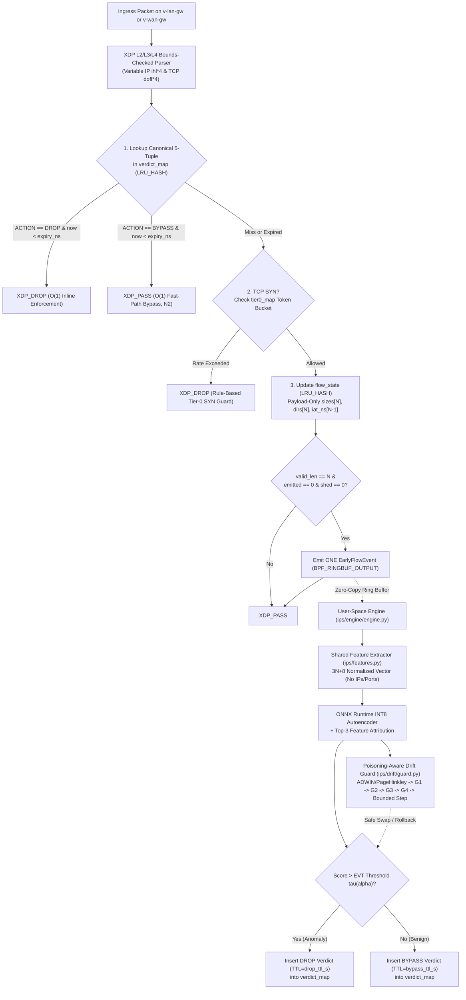

# System Architecture (`docs/ARCHITECTURE.md`)

## 1. Two-Tier Kernel / User-Space Co-Design

The system implements a resource-aware, closed-loop inline Intrusion Prevention System (IPS) for encrypted IoT gateway traffic without TLS decryption (no MITM). Packet inspection and enforcement are split across an **eBPF/XDP Kernel Fast Path** (`ebpf/ips_engine.c`) and a **User-Space Inference & Drift Guard Engine** (`ips/engine/engine.py`, `ips/drift/guard.py`).

---

## 2. Single Source of Truth Schema (`ips/engine/schema.py`)

To prevent desynchronization between kernel C structs and Python `ctypes` structures (Defect F10), `ips/engine/schema.py` reads `configs/system.yaml` at startup and dynamically generates:
1. Preprocessor macros (`EARLY_N`, `FLOW_MAP_MAX`, `VERDICT_MAP_MAX`, `SCHEMA_VERSION 2`) prepended to `ebpf/ips_engine.c` before BCC compilation.
2. Matching 8-byte-aligned `ctypes.Structure` classes (`FlowKey`, `VerdictEntry`, `CfgEntry`, `StatsEntry`, `EarlyFlowEvent`).

---

## 3. Component Summary

| Layer | Module | Role |
|-------|--------|------|
| Kernel Fast Path (Tier 0 / Tier 1) | `ebpf/ips_engine.c` | Bidirectional XDP attachment (`v-lan-gw` + `v-wan-gw`), `verdict_map` enforcement/bypass with monotonic TTL, Tier-0 SYN token bucket, payload-only early-flow tracking (`flow_state`), single `EARLY_FLOW` ring-buffer emission |
| Schema & Bridge | `ips/engine/schema.py` | Generates C defines and `ctypes` structures from `configs/system.yaml` |
| Shared Features | `ips/features.py` | Computes `3N + 8` normalized early-flow vector (`sizes`, `dirs`, `log_iats`, 9 aggregates) with shortcut-learning guard |
| Offline Extractor | `ips/offline/pcap_to_flows.py` | Extracts canonical bidirectional flows from pcaps identically to the kernel |
| Anomaly Models & Quantization | `ips/models/{autoencoder,evt,quantize,train,eval_offline}.py` | Global AE, Per-Class AE, Kitsune-style ensemble, Isolation Forest, GPD POT EVT calibration with KS selection, ONNX FP32 & INT8 export |
| Closed-Loop Engine & Watchdog | `ips/engine/engine.py` | Consumes ring buffer, runs INT8 inference, writes `BYPASS`/`DROP` verdicts, runs 1 Hz overload watchdog (`cfg.shed`) |
| Poisoning-Aware Drift Guard & Slow-C2 | `ips/drift/{guard,periodicity,scenarios}.py` | Primary novelty N1 (G1 persistence, G2 cross-device consistency, G3 non-periodicity, G4 quarantine + anchor/canary validation, bounded step, rollback) and N4 Tier-2 `SlowC2Tracker` |

