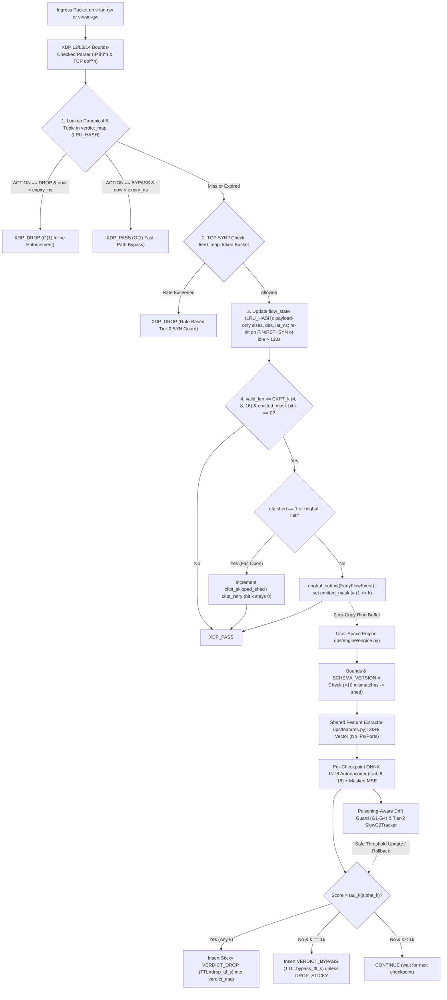
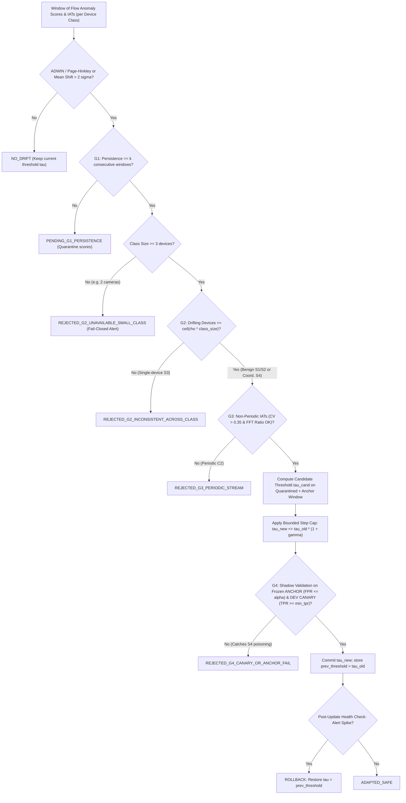
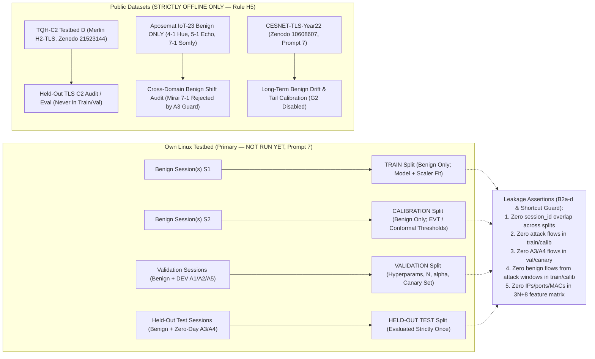

# System Architecture (`docs/ARCHITECTURE.md`)

> **Rendering Note**: `mmdc` (Mermaid CLI) is not installed on the current Windows host, so diagrams are stored as native Mermaid source blocks below. Render them directly on GitHub, in VS Code (Markdown Preview Mermaid Support), or export PNG/SVG with `npx @mermaid-js/mermaid-cli -i docs/ARCHITECTURE.md -o demo/figures/diagrams/arch.png`.
> **Verification Status**: Kernel C code (`ebpf/ips_engine.c`) is `CODE WRITTEN, NOT COMPILED, NOT RUN (V2)` on Linux. Python mirrors and offline modules are `UNIT TEST` verified (V1).

---

## 1. Two-Tier Kernel / User-Space System Overview

The system splits encrypted-traffic inspection and enforcement (no TLS decryption / no MITM) between an **eBPF/XDP Kernel Fast Path** (`ebpf/ips_engine.c`, `SCHEMA_VERSION 4`) and a **User-Space Inference & Drift Guard Engine** (`ips/engine/engine.py`, `ips/drift/guard.py`).



---

## 2. Progressive Checkpoint Sequence (One Connection Through Checkpoints 4 / 8 / 16)

```mermaid
sequenceDiagram
    participant Dev as IoT Device / Attacker
    participant XDP as XDP Fast Path (ebpf/ips_engine.c)
    participant RB as BPF Ring Buffer
    participant Eng as User-Space Engine (ips/engine/engine.py)
    participant VMap as verdict_map (LRU_HASH)

    Dev->>XDP: TCP SYN / SYN-ACK / ACK (payload_len == 0)
    XDP-->>Dev: XDP_PASS (zero-payload packets do not advance valid_len)

    Dev->>XDP: Payload packets 1..4 (TLS ClientHello / ServerHello / AppData)
    XDP->>RB: ringbuf_submit(checkpoint_idx=0, valid_len=4); emitted_mask |= 0x1
    RB->>Eng: Deliver EarlyFlowEvent (k=4)
    Eng->>Eng: Score 3(4)+8=20 features via AE_k4 vs tau_4(alpha_4)

    alt Attack detected early at k=4
        Eng->>VMap: Write VERDICT_DROP (TTL=drop_ttl_s)
        Dev->>XDP: Payload packet 5..N
        XDP->>VMap: Lookup 5-tuple -> VERDICT_DROP
        XDP--xDev: XDP_DROP immediately (packets 5..N blocked inline)
    else Benign at k=4 (CONTINUE)
        Eng-->>Eng: Write nothing (CONTINUE)
        Dev->>XDP: Payload packets 5..8
        XDP->>RB: ringbuf_submit(checkpoint_idx=1, valid_len=8); emitted_mask |= 0x2
        RB->>Eng: Deliver EarlyFlowEvent (k=8)
        Eng->>Eng: Score 3(8)+8=32 features via AE_k8 vs tau_8(alpha_8)
        Note over Eng,VMap: Early DROP if score > tau_8; else CONTINUE to k=16
        Dev->>XDP: Payload packets 9..16
        XDP->>RB: ringbuf_submit(checkpoint_idx=2, valid_len=16); emitted_mask |= 0x4
        RB->>Eng: Deliver EarlyFlowEvent (k=16)
        Eng->>Eng: Score 3(16)+8=56 features via AE_k16 vs tau_16(alpha_16)
        alt Benign at final checkpoint k=16 (and not DROP_STICKY)
            Eng->>VMap: Write VERDICT_BYPASS (TTL=bypass_ttl_s)
            Dev->>XDP: Payload packets 17..end
            XDP->>VMap: Lookup 5-tuple -> VERDICT_BYPASS
            XDP-->>Dev: XDP_PASS in O(1) (zero user-space events)
        else Anomaly at k=16
            Eng->>VMap: Write VERDICT_DROP (TTL=drop_ttl_s)
        end
    end
```

---

## 3. Poisoning-Aware Drift Guard Decision Flow (`G1–G4` + Bounded Step + Rollback)



---

## 4. Data Splits, Session Isolation & Leakage Governance (`ips/data/build_splits.py`)



---

## 5. Single Source of Truth Schema (`ips/engine/schema.py` & `ips/features.py`)

To prevent desynchronization between kernel C structs and Python `ctypes` structures, `ips/engine/schema.py` reads `configs/system.yaml` at startup and generates:
1. Preprocessor macros (`EARLY_N`, `CKPT_0..2`, `NUM_CHECKPOINTS`, `FLOW_IDLE_NS`, `FLOW_MAP_MAX`, `VERDICT_MAP_MAX`, `SCHEMA_VERSION 4`) prepended to `ebpf/ips_engine.c` before BCC compilation.
2. Matching 8-byte-aligned `ctypes.Structure` classes (`FlowKey`, `VerdictEntry`, `CfgEntry`, `StatsEntry` [72 B], `EarlyFlowEvent`).

### 5.1 Feature Normalisation Choice (`FEATURE_SCHEMA_VERSION = 2`, Prompt 9 Item 2)
In `ips/features.py::build_early_vector`, per-packet inter-arrival times are normalised via a fixed, stateless log scale:
$$\text{log\_iat}_i = \min\!\left(1.5,\; \frac{\log_{10}(1 + \text{iat\_us}_i)}{7.0}\right)$$
matching the aggregate `mean_log_iat / 7.0` (`10^7 µs = 10 s -> 1.0`; `1 h = 3.6×10^9 µs -> 1.365 <= 1.5`), alongside `sizes / 1500.0`, `dirs in {0,1}`, and bounded aggregates in `[0, 1.5]`. We deliberately chose fixed physical scaling (`/ 7.0` + clip `[0, 1.5]`) over train-split `z`-score standardisation because:
1. **Zero scaler-leakage surface**: No fitted mean/std state can accidentally leak across train/calibration/validation/test or cross-domain splits.
2. **Stateless online/offline parity**: `IPSEngine.handle_early_flow_event`, `pcap_to_flows.py`, and all dataset adapters call `build_early_vector` directly without carrying external scaler artifacts alongside ONNX models.
3. **Balanced squared-error contribution**: Previously (`FEATURE_SCHEMA_VERSION = 1`), raw `log10(1 + iat_us)` spanned `[0, ~7.5]` (`~50×` larger squared error than `sizes`), dominating autoencoder MSE. Dividing by `7.0` puts all feature groups on `[0, 1.5]`.

---

## 6. Component Summary

| Layer | Module | Role | Current Verification |
|-------|--------|------|----------------------|
| Kernel Fast Path (Tier 0 / Tier 1) | `ebpf/ips_engine.c` | Bidirectional XDP (`v-lan-gw` + `v-wan-gw`), `verdict_map` with TTL, Tier-0 SYN token bucket, payload-only early-flow tracking, FIN/RST/idle reset, progressive checkpoint ringbuf emission | `CODE WRITTEN, NOT COMPILED, NOT RUN (V2)`; V1 source-guard + Python mirror PASS |
| Schema & Bridge | `ips/engine/schema.py` | Generates C defines (`SCHEMA_VERSION 4`) and `ctypes` structures from `configs/system.yaml` | `UNIT TEST` PASS (V1) |
| Shared Features | `ips/features.py` | Computes `3N + 8` normalized early-flow vector + masked padding (`build_valid_mask_matrix`) + shortcut-learning guard | `UNIT TEST` PASS (V1) |
| Offline Extractor | `ips/offline/pcap_to_flows.py` | Streaming `dpkt` extractor computing header payload lengths and canonical 5-tuple flow instances | `UNIT TEST` PASS + `REAL PUBLIC DATA` ran on 8 IoT-23 pcaps |
| Anomaly Models & Calibration | `ips/models/{autoencoder,evt,quantize,train,eval_offline}.py` | Per-checkpoint AE `[4, 8, 16]`, Kitsune-style ensemble, Isolation Forest, POT/GPD EVT & split-conformal calibration, ONNX INT8 export | `UNIT TEST` PASS + `SYNTHETIC SMOKE` + exploratory IoT-23 |
| Closed-Loop Engine & Watchdog | `ips/engine/engine.py` | Ringbuf bounds/schema validation, INT8 inference, sticky DROP / late BYPASS verdicts, 1 Hz overload watchdog (`cfg.shed`) | `UNIT TEST` PASS (MockBPFBackend); Linux BCC `NOT RUN (V2)` |
| Drift Guard & Slow-C2 | `ips/drift/{guard,periodicity,scenarios,evasion_cost}.py` | Poisoning-Aware Drift Guard (`G1–G4`, bounded step, rollback), Tier-2 `SlowC2Tracker`, white-box cost-of-evasion (`Q=200`) | `UNIT TEST` PASS + `SYNTHETIC SMOKE` |
